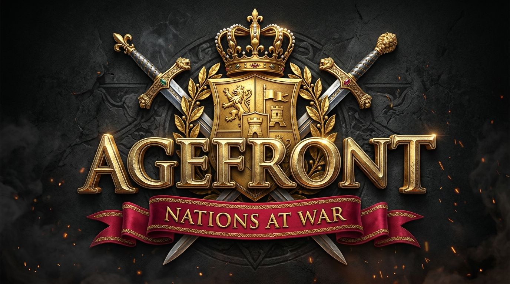

<p align="center">
  
</p>

# Agefront: Nations at War

An epic historical real-time strategy (RTS) game inspired by the strategic depth of *Age of Empires II / III* and the empire-building mechanics of *Rise of Nations*. Features an authentic **Age of Empires** parchment-and-timber visual theme, a definitive **Age of Empires III** in-game HUD layout, offline **Single-Player Skirmish mode**, and genuine **Local Area Network (LAN) Co-op Multiplayer**.

---

## 1. Highlights & Core Features

### 👑 Authentic Age of Empires Visual Aesthetic
- **Deckled Parchment & Timber Planks**: All menus and dialogs feature aged parchment paper cards pinned to dark oak timber backdrops with antique iron corner rivets.
- **Royal Crimson & Beveled Gold Buttons**: Multi-tiered beveled gold trim with deep royal crimson silk gradients and classical Roman serif typography (`Cinzel`).
- **Franchise Masterpiece Title Emblem**: Monumental 3D chiseled antique gold Roman lettering, imperial heraldic fortress shield with lion ramparts, crossed broadswords, golden laurels, and an unfurling royal crimson silk ribbon banner.

### ⚔️ Age of Empires III Definitive Edition HUD Layout
- **Top Bar with Citizen Allocations**:
  - Civilization shield crest with overlapping **idle worker badge** (glows red when citizens are idle; click to cycle and select).
  - Population counter with house icon (`🏠 pop / maxPop`).
  - Resource displays featuring **worker allocation badges** showing how many citizens are actively assigned to each resource:
    - 🥩 **Food**: `[count] Food (+rate)`
    - 🪵 **Timber**: `[count] Wood (+rate)`
    - 🪨 **Stone**: `[count] Stone`
    - 🪙 **Gold (Treasury)**: `[count] Metal`
    - 📜 **Knowledge**: `[count] Knowledge`
    - 📦 **Imperial Shipments**: `[count] Shipments`
  - Gold-beveled Roman numeral **Era Plaque** (`[ I ]` to `[ IV ]`) with live match timer (`00:11:16`).
  - **Quick Action Command Strip** (directly under top-left bar): Idle Settler (`💤`), Select Military (`📯`), Formations/Stances (`⚔️`), Naval Docks (`⚓`), Builders (`🔨`).
- **Top-Right Primary Objectives & Ranked Scoreboard**:
  - **PRIMARY OBJECTIVES**: Interactive task list with gold checkboxes that update in real-time as objectives are fulfilled.
  - **SCORE**: Real-time calculated leaderboard displaying player ranks, nation flag badges, commander names, scores, and alliance status (`[=]` / `[✕]`).
- **Floating Narrator Tutorial Box**: Middle-left floating dialogue box with speech balloon (`💬 NARRATOR`) delivering contextual gameplay hints and empire advice.
- **Bottom-Left Unified Command Console**:
  - **Action Matrix**: 5×3 grid of action slots with hotkey letter badges (`Q`, `W`, `E`, `R`, `T`, `A`, `S`, `D`, `F`, `G`, `Z`, `X`).
  - **Quick Action Sub-bar**: `[ ✕ ] delete` (disband / demolish), `[ 🔨 ] repair` (dispatch builders), `[ 🛡️ ] defend` (defensive stance).
  - **Selected Entity Inspector**: 2D portrait frame, bold gold title, faction/player color dot, health bar with armor ratings (`🛡️ 4`, `🎯 20%`), combat/gather statistics, and active production progress bar.
- **Bottom-Right Circular Brass-Rimmed Minimap**:
  - Circular terrain viewport with fog of war and resource deposits.
  - **Isometric trapezoidal camera view frustum** rendered directly onto the map.
  - Rim icons: **Crossed swords combat alert** and **Signal flare ping horn**.
  - Above-minimap player flag and compact stacked economic summary (`🏠 pop`, `🥩 food`, `🪵 wood`, `🪙 gold`).

---

### 🏛️ Four Playable Civilizations
- **Veyran Confederacy**: Commercial and logistic masters (+15% resource gathering rate, cheaper drop-off camps).
- **Solari Dominion**: Sun scholars (+25% tech research speed, generates passive knowledge over time).
- **Ironvale Kingdom**: Mountain stronghold builders (+30% building and fortification HP, durable infantry).
- **Nambara Alliance**: Nomadic steppe raiders (+20% mounted and scout movement speed, +3 vision range).

---

### 🌲 Five Core Strategic Resources
- 🌾 **Food**: Citizen workers, frontline infantry, economic expansion.
- 🪵 **Wood**: Settlement buildings, farms, bows, and siege chassis.
- 🪨 **Stone**: Watchtowers, castles, fortresses, and stone ramparts.
- 🪙 **Metal / Gold**: Armored knights, cavalry, forged weapons, and heavy artillery.
- 📜 **Knowledge**: Academic research, technology upgrades, and era advancement.

---

### ⏳ Four Historical Ages
- **Age I — Founding Age**: Basic gathering economy, citizen workers, scouts, frontline spearmen, and town centres.
- **Age II — Kingdom Age**: Agricultural crop rotation, archery ranges, horse stables, and watchtowers.
- **Age III — Imperial Age**: Grand fortresses, siege workshops, catapults, armored cavalry, and mythical War Dragons.
- **Age IV — Industrial Age**: Elite vanguard champions, destructive bombards, apex technologies, and instant troop deployment.

---

### 💬 Rise of Nations In-Game Cheat Console (Single Player)
Press **`[Enter]`** during any Single-Player skirmish to open the Commander Chat & Cheat Console:
- `cheat resource all` — Awards +1,000 to all stockpiles (Food, Wood, Stone, Metal, Knowledge).
- `cheat resource <type> <amount>` — Grants custom amounts of a specific resource (e.g. `cheat resource food 5000`).
- `cheat age advance` — Instantly unlocks the next historical era.
- `cheat reveal` — Uncovers the full map terrain and lifts the Fog of War.
- `cheat defeat` — Defeats AI adversaries on the map.
- `cheat victory` — Triggers instant military triumph.
- `cheat help` — Displays the complete cheat code index.
> **Note**: Cheats are strictly disabled in multiplayer LAN matches to ensure fair play.

---

### 🔨 Autonomous & Commanded Citizen Repair
- Damaged buildings can be repaired by selecting workers and right-clicking the structure, or clicking the `[ 🔨 ] repair` button in the unified console.
- Once repairs conclude, citizen workers automatically resume their previous gathering jobs without idling.

---

### 🌐 Authoritative LAN Co-op Multiplayer
- The host machine runs an authoritative real-time simulation server (20 ticks/sec).
- Other devices on the same Wi-Fi network or wired Ethernet connect directly using the host's LAN IP address.
- Allies share team vision and coordinate defense lines and assault waves against AI opponents.
- 100% offline — zero external internet, cloud databases, or third-party accounts required.

---

## 2. Project Architecture

```
agefront/
├── apps/
│   ├── client/               # Three.js 3D WebGL frontend & AoE III HUD
│   │   ├── src/
│   │   │   ├── audio/        # Procedural Web Audio sound synthesizer
│   │   │   ├── camera/       # Isometric constrained RTS camera controller
│   │   │   ├── controls/     # Marquee box select, right-click orders, hotkeys
│   │   │   ├── networking/   # Socket.IO client & offline SP simulation controller
│   │   │   ├── rendering/    # Procedural 3D terrain, buildings, units, circular minimap, fog
│   │   │   ├── ui/           # HUD, Main Menu, LAN War Room Lobby, Victory screens
│   │   │   └── main.ts       # Client bootstrap and 60 FPS render loop
│   │   ├── index.html        # AoE theme styles, fonts, and WebGL container
│   │   ├── vite.config.ts
│   │   └── package.json
│   └── server/               # Node.js + Express + Socket.IO server
│       ├── src/
│       │   ├── lobby/        # Room management & player roster
│       │   ├── network/      # Authoritative 20 TPS simulation loop & socket events
│       │   ├── utils/        # LAN IP auto-detection (os.networkInterfaces)
│       │   └── index.ts      # Server entry point & static file hosting
│       └── package.json
├── packages/
│   └── shared/               # Shared TypeScript simulation engine & rules
│       ├── src/
│       │   ├── constants/    # Civs, units, buildings, and technology tree
│       │   ├── simulation/   # Deterministic SimulationEngine, A* pathfinder, map generator
│       │   └── types/        # Shared game states, commands, and network payloads
│       └── package.json
├── tests/                    # Vitest automated test suite (52 tests)
│   ├── ai_intelligence.test.ts
│   ├── camera_and_maps.test.ts
│   ├── lan_approval.test.ts
│   ├── lan_multiplayer.test.ts
│   ├── privacy.test.ts
│   └── simulation.test.ts
├── docs/                     # Logo assets & game reference documentation
├── package.json              # Root npm workspace configuration
├── tsconfig.json
└── README.md
```

---

## 3. Quick Start & Local Development

### Prerequisites
- Node.js (v18.0.0 or higher recommended)
- npm (v9.0.0 or higher)

### Installation
Clone the repository and install workspace dependencies:
```bash
npm install
```

### Development Mode
To run the server in watch mode:
```bash
npm run dev
```

To run the client frontend independently with Vite HMR:
```bash
npm run dev:client
```

---

## 4. How to Host & Play LAN Multiplayer

The host computer serves both the web client and the authoritative multiplayer server.

### Step 1: Start the LAN Host
On the host machine, run:
```bash
npm run lan
```
The terminal will display the host's direct LAN address, for example:
```
==================================================================
           AGEFRONT: NATIONS AT WAR — LAN MULTIPLAYER
==================================================================
  Server Status: ONLINE
  Local Access:  http://localhost:3000
  LAN Access:    http://192.168.1.37:3000
==================================================================
```

### Step 2: Open Game on Host Computer
Open a web browser on the host machine and visit:
```
http://localhost:3000
```
Click **"Host LAN Game"**, enter your name, pick your civilization, and click **"Open War Room Lobby"**.

### Step 3: Connect Other Computers on the Same LAN
On any laptop or PC connected to the same Wi-Fi or wired network:
1. Open a browser and navigate to the host's LAN Access URL (e.g. `http://192.168.1.37:3000`).
2. Click **"Join LAN Game"**.
3. Select your civilization, team (e.g. Team 1 for Co-op alongside the host), and click **"Connect to Host"**.
4. Click **"Ready Up"**.

### Step 4: Start the Match
Once players are ready, the host can:
- Add additional AI opponents on Team 2.
- Configure map type, AI difficulty, and victory condition.
- Click **"START MATCH"**.

---

## 5. Controls Reference

| Control | Action |
| :--- | :--- |
| **Left Click** | Select single unit or building |
| **Left Drag** | Marquee box select multiple units |
| **Right Click Ground** | Move selected units to location |
| **Right Click Resource** | Order worker(s) to gather food, wood, stone, or metal |
| **Right Click Enemy** | Order unit(s) to attack target |
| **Right Click Damaged Building** | Order worker(s) to repair building |
| **WASD / Arrow Keys** | Pan tactical camera across the map |
| **Mouse Wheel** | Zoom camera in and out |
| **`[Enter]`** | Open In-Game Commander Chat & Cheat Console (Single Player) |
| **`Z`** | Find and select next idle citizen worker |
| **`V`** | Select all active military units |
| **`[Q, W, E, R, T...]`** | Trigger corresponding command matrix action / building |
| **Ctrl + [1–9]** | Assign selected units to control group |
| **[1–9]** | Recall assigned control group |
| **Escape** | Deselect or cancel current building placement |

---

## 6. Running Automated Tests

Run the complete test suite with Vitest:
```bash
npm run test
```
All **52/52** automated tests verify:
- Deterministic seeded procedural map generation across all climates.
- A* grid pathfinding and collision avoidance.
- Citizen worker gathering, returning resources, constructing foundations, and repairing.
- Unit training, population caps, and resource deductions.
- Combat counter bonus calculations (e.g. Spearmen vs Cavalry).
- Age advancement and tech tree upgrades.
- Multi-client real-time LAN socket synchronization and approval flow.
- Server privacy safeguards and internal socket masking.

---

## 7. Building for Production

Compile all packages and apps:
```bash
npm run build
```
To run the production server:
```bash
npm run start
```

---

## 8. Asset Attribution & License

- **Visual Theme & UI**: Custom handcrafted CSS/HTML suite modeling the classical deckled parchment, timber backdrops, and beveled gold/crimson styling of the *Age of Empires* franchise.
- **Graphics**: Procedural 3D models and terrain built dynamically with Three.js geometries and vertex-shaded materials.
- **Audio**: 100% procedural sound effects and ambient orchestral melodies synthesized in real-time via the browser's native Web Audio API (`AudioContext`). No proprietary or commercial assets copied.
